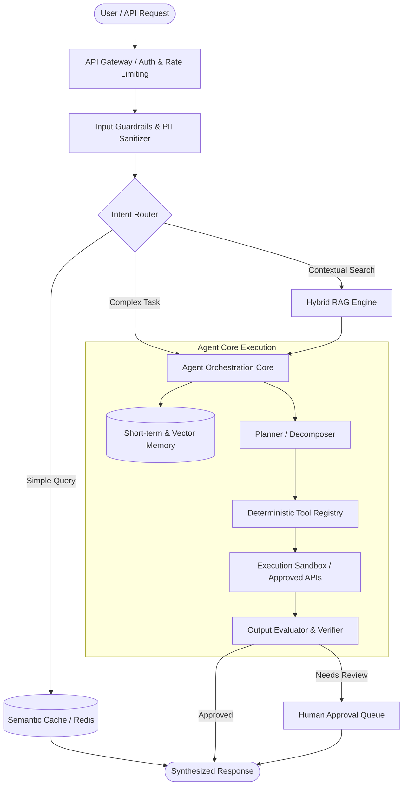
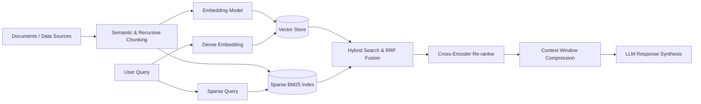

# ⚡ Production AI Agent Patterns & System Design

> **Architectural blueprints, battle-tested system design patterns, and runnable implementations for deploying reliable, resilient, and enterprise-grade autonomous AI agents.**

---

## 📌 Table of Contents

- [Architectural Overview](#-architectural-overview)
- [Core Agent Architecture Patterns](#-core-agent-architecture-patterns)
  - [1. ReAct (Reason + Act) with Tool Calling](#1-react-reason--act-with-tool-calling)
  - [2. Plan-and-Solve (Hierarchical Planning)](#2-plan-and-solve-hierarchical-planning)
  - [3. Orchestrator-Workers (Multi-Agent Swarm)](#3-orchestrator-workers-multi-agent-swarm)
  - [4. Reflexion & Self-Correction](#4-reflexion--self-correction)
  - [5. Human-in-the-Loop (HITL) Guardrail](#5-human-in-the-loop-hitl-guardrail)
- [Enterprise RAG Architecture](#-enterprise-rag-architecture)
- [Vector Database Decision Matrix](#-vector-database-decision-matrix)
- [Production Readiness Checklist](#-production-readiness-checklist)
- [Code Implementations](#-code-implementations)
- [Contributing](#-contributing)
- [License](#-license)

---

## 🏗 Architectural Overview

Modern production AI agents require more than simple prompt chaining. They demand resilient memory architectures, deterministic tool-calling schemas, observability pipelines, and rigorous guardrails.

---

## 🧠 Core Agent Architecture Patterns

### 1. ReAct (Reason + Act) with Tool Calling
* **When to use:** Interactive troubleshooting, multi-step API integrations, diagnostic agents.
* **Mechanism:** The agent iteratively generates thought traces and calls specific typed tools, consuming observations until reaching a final conclusion.
* **Key advantage:** Interpretable decision logs, step-by-step auditability.

### 2. Plan-and-Solve (Hierarchical Planning)
* **When to use:** Long-horizon tasks (e.g., code generation, deep research, financial data aggregation).
* **Mechanism:** Separates global task decomposition from individual step execution. An executive model produces a structured DAG of milestones; specialized worker agents execute sub-tasks in parallel or series.

### 3. Orchestrator-Workers (Multi-Agent Swarm)
* **When to use:** Multi-domain tasks requiring distinct system prompts, permission boundaries, and specialized tools.
* **Mechanism:** A centralized coordinator delegates sub-tasks to specialized domain agents (e.g., Database Analyst, Python Coder, Security Auditor) and synthesizes their outputs.

### 4. Reflexion & Self-Correction
* **When to use:** High-precision tasks (e.g., SQL generation, code compilation, contract extraction).
* **Mechanism:** Incorporates verbal reinforcement learning by capturing tool error traces (stack traces, schema violations) and feeding them back to the LLM to refine its response before user delivery.

### 5. Human-in-the-Loop (HITL) Guardrail
* **When to use:** Irreversible actions (financial transactions, production deployments, database writes, external emails).
* **Mechanism:** Enforces an asynchronous approval breakpoint that generates a cryptographic callback token requiring verified operator sign-off before committing state changes.

---

## 🔍 Enterprise RAG Architecture

---

## 📊 Vector Database Decision Matrix

| Vector Store | Deployment | Latency SLA | Best For | Filtering Power |
| :--- | :--- | :--- | :--- | :--- |
| **pgvector** | Self-hosted / Managed PG | < 15ms | Existing PostgreSQL stacks, hybrid relational queries | ⭐⭐⭐⭐⭐ (Full SQL) |
| **Qdrant** | Cloud / Open Source (Rust) | < 5ms | High-throughput search, rich payload filtering | ⭐⭐⭐⭐⭐ (Native JSON) |
| **Milvus** | Distributed Kubernetes | < 10ms | Billions of vectors, enterprise scale | ⭐⭐⭐⭐ |
| **Pinecone** | Fully Managed SaaS | < 25ms | Zero-ops prototyping, serverless architecture | ⭐⭐⭐⭐ |

---

## 🛡️ Production Readiness Checklist

- [x] **Deterministic Tool Schemas:** Use Pydantic or JSONSchema with strict mode (`strict: true`).
- [x] **Idempotency Keys:** Ensure write actions take unique request UUIDs to prevent double execution.
- [x] **Circuit Breakers & Max Iterations:** Enforce maximum step limits (e.g., `max_iterations = 10`) to prevent infinite loops.
- [x] **Semantic Caching:** Cache embedding cosine distances > 0.95 to slash token costs by up to 40%.
- [x] **Observability & Tracing:** Instrument agent runs with OpenTelemetry or Langfuse to monitor token usage, latency, and step timelines.
- [x] **Prompt Injection Defense:** Isolate untrusted inputs into designated XML/delimiter blocks and validate outputs against secondary classifier models.

---

## 💻 Code Implementations

Check out the practical, runnable implementations in the [`examples/`](examples/) folder:

1. [`examples/01_react_tool_calling_agent.py`](examples/01_react_tool_calling_agent.py) - Clean, native Python tool-calling loop with typed schemas and error recovery.
2. [`examples/02_hybrid_rag_pipeline.py`](examples/02_hybrid_rag_pipeline.py) - BM25 sparse + dense semantic search with Reciprocal Rank Fusion (RRF).
3. [`examples/03_human_in_the_loop_guard.py`](examples/03_human_in_the_loop_guard.py) - Asynchronous approval gate for sensitive tool executions.

---

## 🤝 Contributing

Contributions, bug reports, and pattern additions are warmly welcomed! Please review [CONTRIBUTING.md](CONTRIBUTING.md) before submitting a pull request.

## 📄 License

This repository is licensed under the [MIT License](LICENSE).

---

  <b>⭐ If you find this architecture handbook useful, please star this repository! ⭐</b>

### Visual QA & Zero-Trust Remediation Patterns
- [04_visual_qa_action_engine.py](examples/04_visual_qa_action_engine.py): Multimodal Action Engine for parsing visual bug telemetry.
- [05_zero_trust_patch_validator.py](examples/05_zero_trust_patch_validator.py): Zero-trust patch validation and blast radius scoring.
- [06_sliding_window_rate_limiter.py](examples/06_sliding_window_rate_limiter.py): Sliding window rate limiting utility.
- [07_prometheus_telemetry_exporter.py](examples/07_prometheus_telemetry_exporter.py): OpenMetrics / Prometheus scrape exporter.
- [VISUAL_SELF_HEALING.md](docs/VISUAL_SELF_HEALING.md): Closed-loop visual self-healing architecture.
- [ZERO_TRUST_CODE_GEN.md](docs/ZERO_TRUST_CODE_GEN.md): Security guide for agentic code generation.
