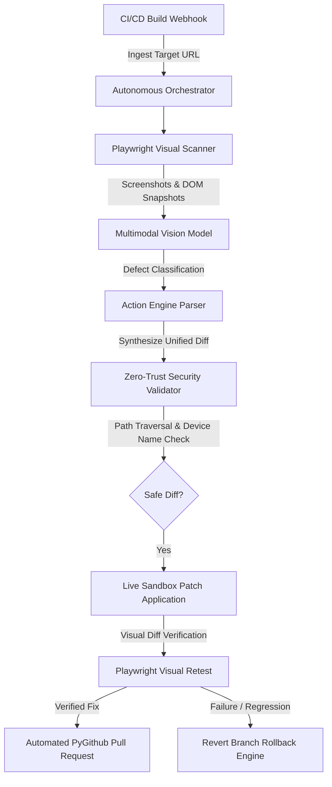

# Visual Self-Healing AI Architecture Pattern

> **Specification**: Autonomous Visual QA Remediation & Closed-Loop Verifier  
> **Author**: Sri khyathi  
> **Date**: October 27, 2026  

## Architecture Overview

## Security Guardrails

1. **Zero-Trust File Access**:
   All synthesized patch hunks are strictly restricted to frontend style files (`.css`, `.jsx`, `.tsx`). Path traversal attempts (`../`) and Windows reserved device names (`CON`, `PRN`, `AUX`, `NUL`, `COM1-9`, `LPT1-9`) are rejected before disk interaction.
2. **Cryptographic Webhook Signatures**:
   All external CI/CD webhook events are validated using constant-time HMAC-SHA256 signature verification matching GitHub's `X-Hub-Signature-256` protocol.
3. **Bounded Remediation Limits**:
   Retries are bounded by configurable ceilings (`max_retries = 3`) to eliminate runaway self-healing loops.
